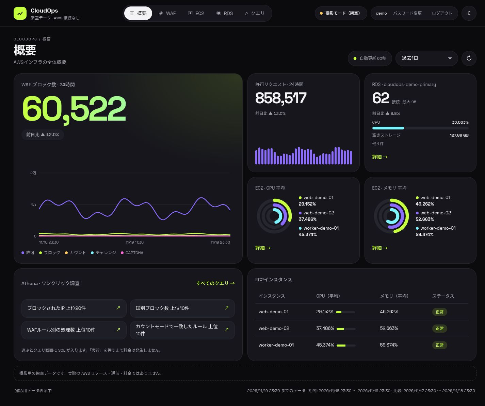

# CloudOps

**AWS WAF, EC2, and RDS metrics in one dashboard.**

[日本語](README.md) | **English**

CloudOps is a self-hosted AWS monitoring dashboard built with Go and plain HTML, CSS, and JavaScript. Check infrastructure health, explore request patterns, compare periods, and investigate WAF logs with Athena when you need more detail.

The interface is in Japanese and supports light and dark themes. Run it with Docker Compose locally or deploy it behind an HTTPS Application Load Balancer on EC2.



*Captured with fictional screenshot data. See the [feature guide](docs/features.en.md) for the full gallery.*

## Project background and goals

Day-to-day AWS operations often involve checking WAF traffic alongside EC2 resource usage and RDS load. CloudOps brings those signals together so operators can review them without switching between service consoles, then investigate WAF logs when more detail is needed.

The intended audience is engineers and small teams operating a defined set of AWS resources. Monitored resources are configured explicitly, with a shared interface for routine checks, comparisons with the preceding period, and request investigations. The UI is in Japanese, with setup and usage documentation in Japanese and English.

The implementation focuses on four priorities:

- **Predictable operating costs:** Cache metrics, pause collection when idle, and combine manual Athena execution with spending limits to reduce unnecessary API usage.
- **Straightforward deployment and maintenance:** Embed the frontend in the Go binary and use SQLite and Docker Compose to keep the application's deployment components together.
- **Clear data boundaries:** Show unavailable real metrics explicitly and isolate fictional presentation and testing data in a dedicated mode.
- **Operational behavior:** Include login, sessions, auditing, SQL execution limits, persistence, and deployment behind HTTPS alongside metric visualization.

The repository presents an implementation spanning AWS API integration in Go, the user interface, usage controls, tests, and container operations.

## Features

| View | What it shows |
| --- | --- |
| Overview | WAF allowed and blocked requests, EC2 CPU and memory, and RDS connections at a glance |
| WAF | Action trends, blocked requests by rule, and sampled requests from the last three hours |
| EC2 | Instance health, average and peak CPU and memory, and time series charts |
| RDS | CPU, connections, write latency, and free storage |
| Queries | Athena queries over WAF logs, saved SQL, execution history, results, and CSV downloads |

- Choose the last day, seven days, 30 days, or a custom range of up to 90 days.
- The URL preserves the page and applied period across reloads, shared links, login, and browser back/forward, including custom start and end times.
- Compare metrics with the preceding period of the same length.
- Charts reveal from left to right, and rings fill to their values; automatic refreshes and reduced motion preferences skip the entrance animation.
- Sign in with individual sessions, audit logs, and query result sharing controls.
- Persist users, sessions, audit logs, query history, and usage records in SQLite.

WAF sampled requests are a subset of traffic. Use Athena to investigate the full logs. EC2 memory metrics require a metric publisher such as the CloudWatch Agent.

See the [feature guide](docs/features.en.md) for a tour of each view and screenshots.

## Cost controls

Collected metrics are cached, and periodic collection pauses when the dashboard is idle. Automatic page refreshes read the cache. Athena runs only when someone explicitly starts a query.

Athena has an estimated daily spending limit, a required partition range filter, and a limit of one running query at a time. A spending lock persists until released; it does not reset automatically. Costs are estimates, and one in-flight query can take spending beyond the limit.

## Try it without AWS

Install Docker and the Docker Compose plugin, then run these commands from the repository root. These examples use Linux / macOS.

```bash
docker compose --env-file /dev/null -f docker-compose.screenshot.yml up -d --build
docker compose --env-file /dev/null -f docker-compose.screenshot.yml exec cloudops /app/cloudops user add demo
```

Open [http://127.0.0.1:8083](http://127.0.0.1:8083) and sign in as `demo` using the password printed by the command. On Windows, replace `/dev/null` with an empty environment file.

This `screenshot` mode displays **fictional data** in charts, events, and query results. It needs no AWS credentials, makes no AWS connections, and disables query execution and CSV downloads. Its database is separate from the regular environment.

To stop it:

```bash
docker compose --env-file /dev/null -f docker-compose.screenshot.yml down
```

## Connect your AWS environment

1. Copy `config.example.json` to `config.json` and `.env.local.example` to `.env.local`. Preserve any existing configuration.
2. Set your region, EC2 / RDS resources, WAF, and AWS profile. For Athena, also prepare the log table, workgroup, and S3 results destination.
3. Authenticate with AWS on the host, then run:

```bash
docker compose --env-file .env.local up -d --build
docker compose --env-file .env.local exec cloudops /app/cloudops user add your-user
```

The local example uses [http://127.0.0.1:8082](http://127.0.0.1:8082). See the [configuration and operations guide](docs/operations.en.md) for Windows settings, IAM permissions, EC2 + ALB deployment, user management, and backups.

In `aws` mode, missing metrics are never replaced with fictional values. An empty `demo` mode is also available.

## Technology

| Layer | Technology |
| --- | --- |
| Backend | Go 1.27.4, standard HTTP server, AWS SDK for Go v2 |
| Frontend | HTML, CSS, JavaScript; no framework or frontend build step |
| Persistence | SQLite in pure Go; no CGO |
| Runtime | Docker Compose, distroless nonroot image |
| AWS integration | CloudWatch, WAF, EC2, RDS, Athena, S3, STS |

```text
app/         Go code, tests, and embedded frontend
queries/     SQL templates for investigating WAF logs
deploy/      Example IAM policies and EC2 setup
docs/        Configuration and operations guide
```

## Operational notes

- AWS mode incurs charges for services such as CloudWatch and Athena.
- Configure HTTPS and access restrictions before exposing the dashboard. Use an IAM role on EC2.
- All users have the same capabilities. User administration is performed through the container CLI.
- Keep `.env`, `config.json`, credentials, and databases out of public repositories.
- Aggregation and Athena partitions use UTC; display timestamps use the configured timezone. Custom range inputs use JST.

## Development and documentation

Run the tests on Linux / macOS:

```bash
docker run --rm -v "$PWD:/src" -w /src golang:1.27.4-alpine go test ./...
```

- [Features and screenshots](docs/features.en.md)
- [Configuration and operations guide](docs/operations.en.md)
- [Writing saved queries](queries/README.en.md)
- [日本語 README](README.md)
