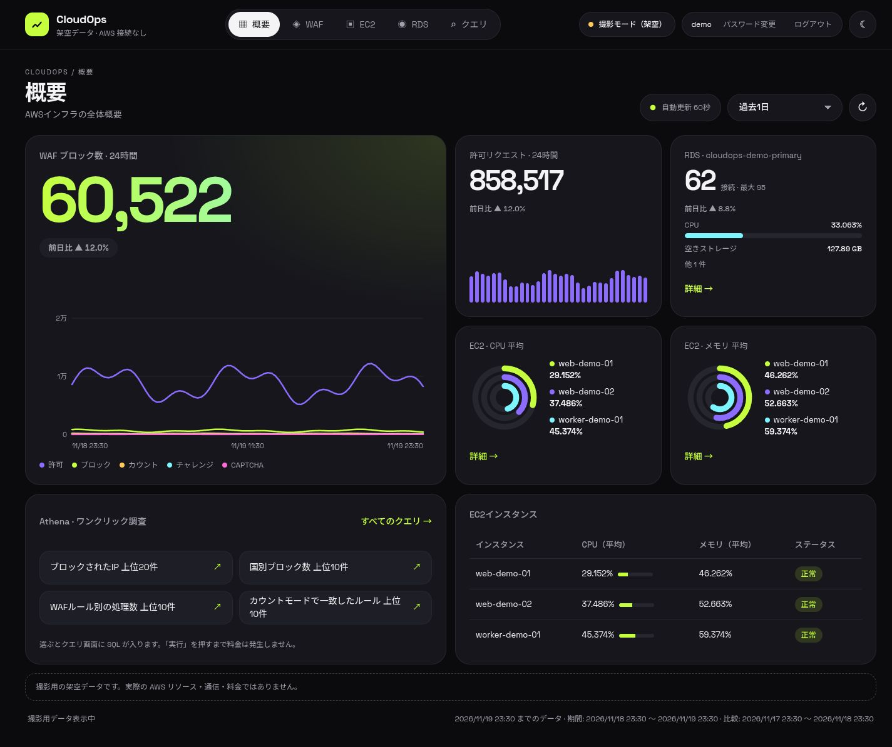
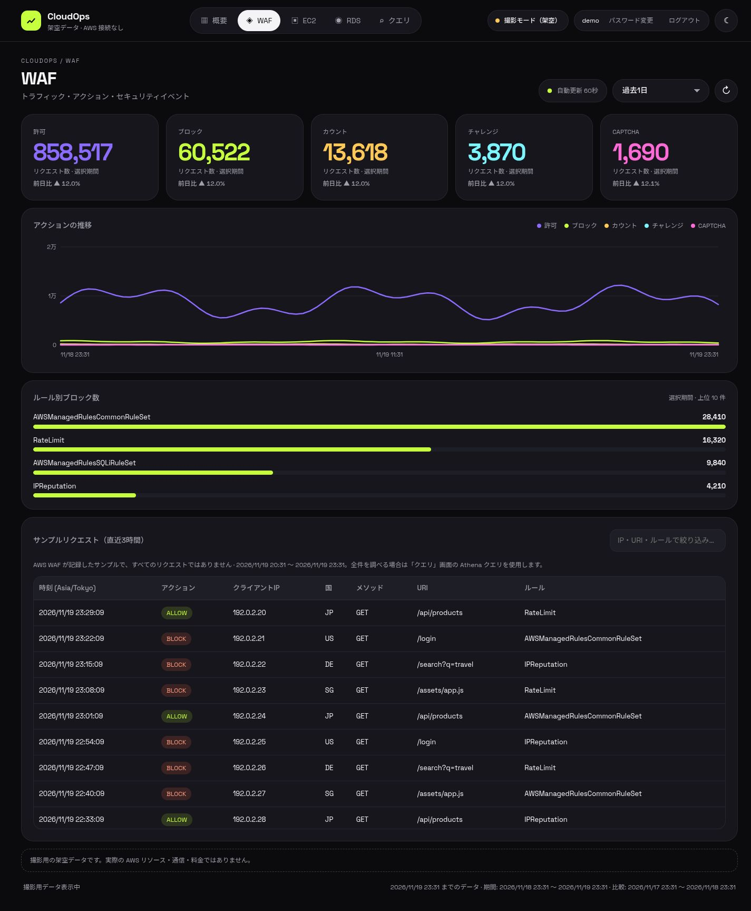
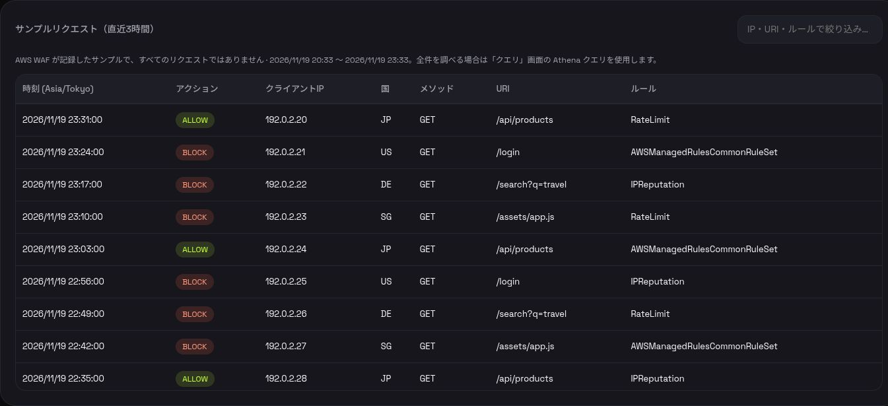
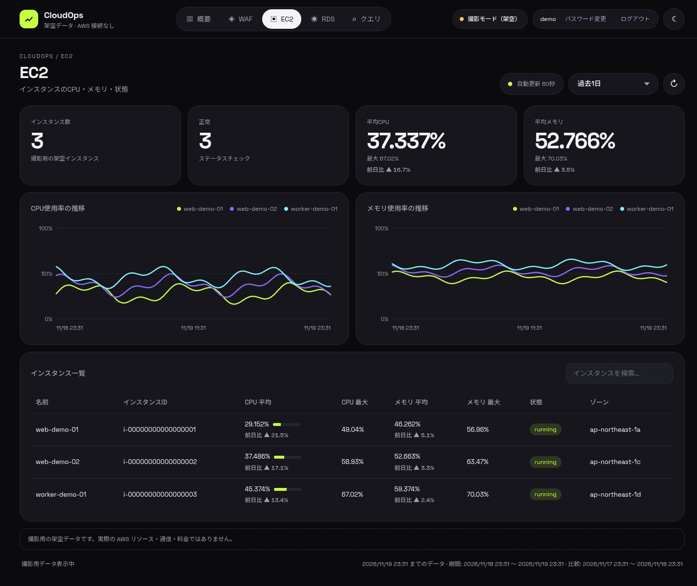
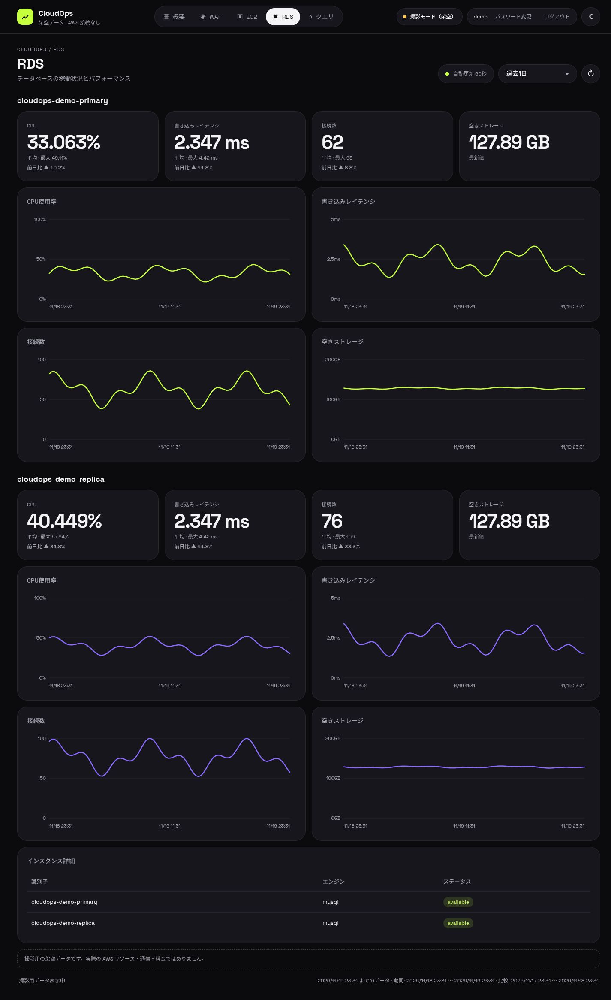
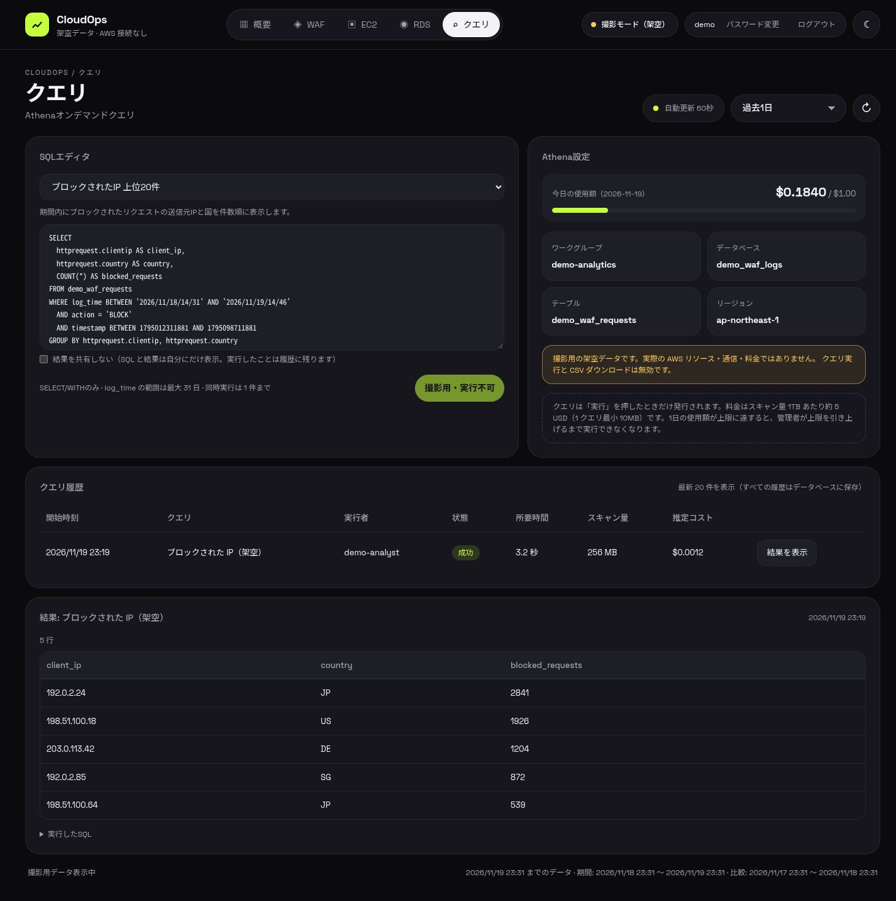
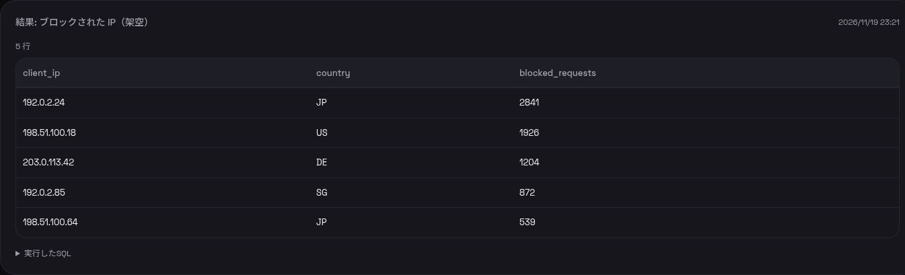
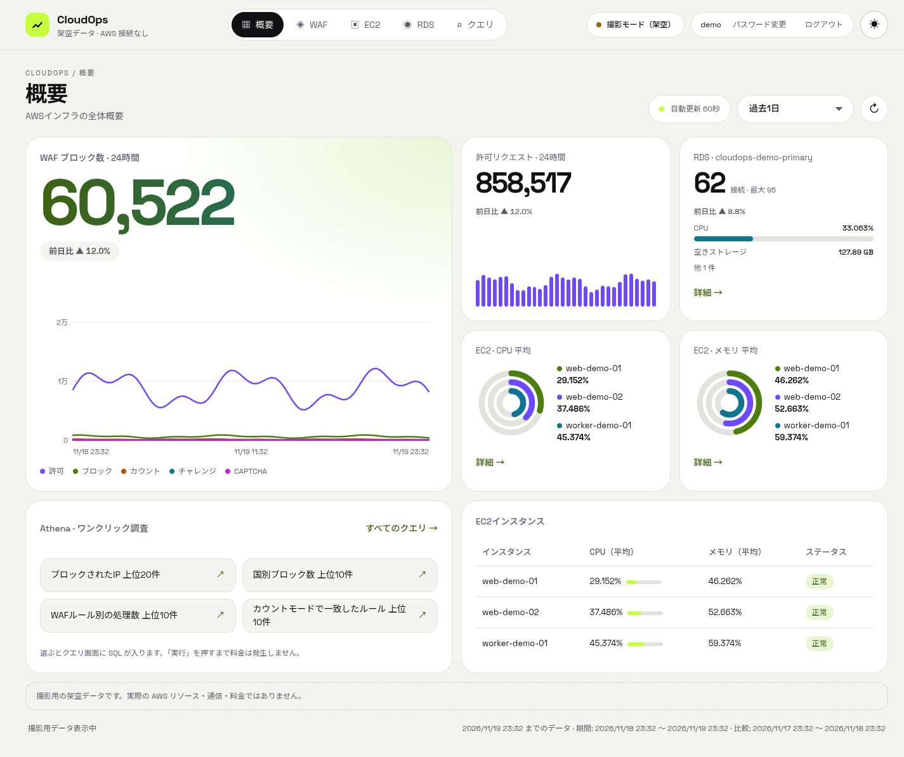
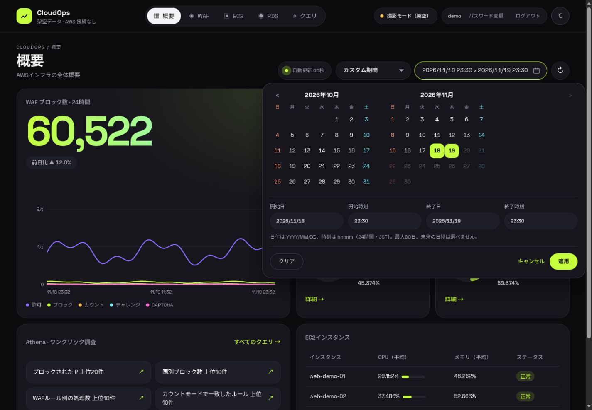
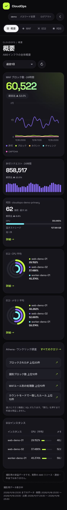

# CloudOps features

[Project overview](../README.en.md) · [日本語](features.ja.md) | **English**

A tour of each view and the information it provides. The interface is in Japanese and supports light and dark themes.

These screenshots were captured using fictional data from `screenshot` mode, without personal or production information. See the [README](../README.en.md#try-it-without-aws) for startup instructions.

## 1. Overview

Check the state of your infrastructure in one view.

- **WAF blocked and allowed requests:** See totals for the selected period and changes from the preceding period.
- **EC2 CPU and memory:** Rings show average usage by instance. Each legend entry places the instance name above its percentage.
- **RDS summary:** Check connections, CPU, and free storage.
- **Investigation shortcuts:** Load a saved query into the editor. Selecting it does not execute it.
- **EC2 table:** Compare average CPU, average memory, and instance health.

### Screenshot

## 2. WAF

Investigate request patterns and rule activity.

- **Action totals and trends:** View allowed, blocked, counted, challenged, and CAPTCHA requests.
- **Blocked requests by rule:** See the top 10 rules for the selected period.
- **Sampled requests:** Inspect timestamps, actions, IPs, countries, methods, URIs, and rules from the last three hours. Filter by IP, URI, or rule.
- **Action colors:** Sample rows use green for ALLOW, red for BLOCK, blue for COUNT, and yellow for CHALLENGE / CAPTCHA. Japanese labels are also supported.

Samples are a subset of traffic and always cover the last three hours, regardless of the selected dashboard period. Use Athena to investigate full logs. This view does not use Athena.

### Screenshots

## 3. EC2

Check instance health and resource usage.

- **Summary cards:** Instance count, healthy instance count, average CPU, and average memory.
- **Time series:** Compare CPU and memory trends across instances.
- **Instance table:** Names, IDs, average and peak CPU and memory, running state, and Availability Zone.
- **Search:** Filter the instance list.

Memory usage requires a metric publisher such as the CloudWatch Agent. In AWS mode, unavailable values appear as `データなし` (no data).

### Screenshot

## 4. RDS

Inspect database load and capacity trends.

- **CPU usage:** Average, peak, and time series.
- **Connections:** Average and peak connections, with trends.
- **Write latency:** Average, peak, and trends in milliseconds.
- **Free storage:** Latest available capacity and its time series.
- **Instance details:** Identifier, database engine, and status.

### Screenshot

## 5. Athena queries

Investigate WAF logs with SQL. AWS mode requires Athena, Glue, and S3 configuration and permissions.

- **Saved queries:** Choose SQL templates for IPs, countries, rules, and other investigations, then edit before execution.
- **SQL editor:** Accepts read-only `SELECT` / `WITH` queries and requires a `log_time` range filter.
- **Spending display:** See today's estimated spending and its limit. Reaching the limit blocks further execution.
- **Execution history:** Inspect the author, status, duration, bytes scanned, and estimated cost. Cancel a running query.
- **Results:** Display up to 1,000 rows and download the full results as CSV.
- **Sharing controls:** Mark a query private to restrict its SQL, results, errors, and CSV to its author. Other users can still see history metadata such as the author and status.

Only one query can run at a time. In `screenshot` mode, results and spending are fictional; SQL execution and CSV downloads are disabled.

### Screenshots

## 6. Shared features

| Feature | Behavior |
| --- | --- |
| Period selection | Last day, seven days, 30 days, or a custom range of up to 90 days |
| Period comparison | Changes relative to the immediately preceding period of equal length |
| Themes | Switch between light and dark; the browser remembers your choice |
| Automatic refresh | Read the cache every 60 seconds, excluding custom ranges and hidden tabs |
| Manual refresh | Fetch updated data for the selected period |
| Sign-in | Individual sessions and self-service password changes |
| Audit logs | Record actions such as sign-ins and query execution in SQLite |
| Idle collection pause | Pause periodic collection when idle and resume on the next visit |

Aggregation uses UTC, display timestamps use the configured timezone, and custom range inputs use JST. User administration and spending lock release use the container CLI.

### Screenshots

### Mobile layout

View the overview at smartphone width

## Related documentation

- [Project overview and startup](../README.en.md)
- [Configuration and operations guide](operations.en.md)
- [Writing saved queries](../queries/README.en.md)
